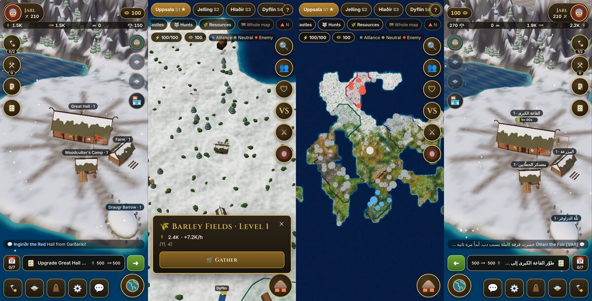
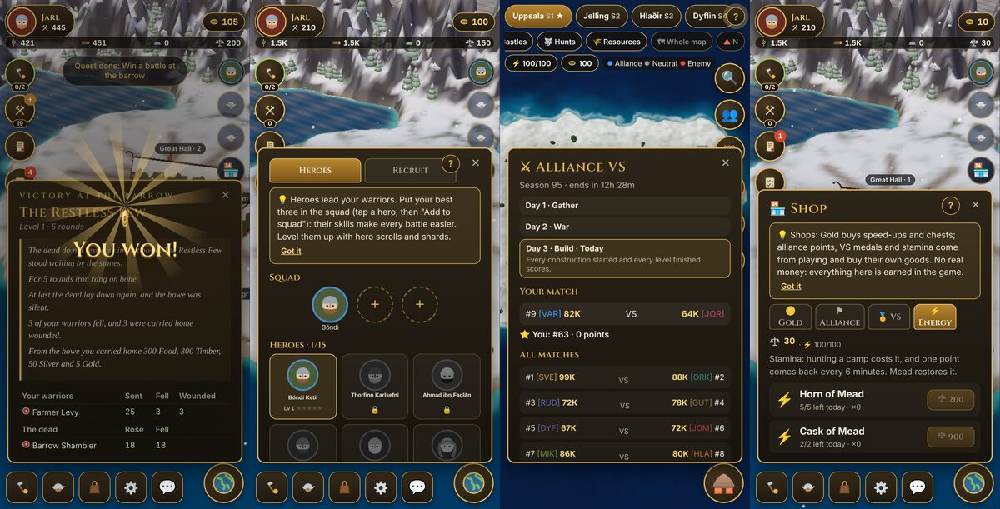

# ⚔️ Jarlheim

> *"Cattle die, kinsmen die… but fame never dies for the one who earns it."* (after *Hávamál*)

**A free 3D Viking strategy game you play right in your phone's browser. No download, no store, no payments. Just your hold, your army, your alliance and a whole living realm to conquer.**

### ▶️ Play now: **[jarlheim.vercel.app](https://jarlheim.vercel.app)**

📱 Open it on your phone and add it to your home screen (**iPhone:** Share → *Add to Home Screen* · **Android:** ⋮ menu → *Add to Home screen*). Jarlheim then opens like a real app: full screen, its own icon, one tap away.





---

## 🧭 The story behind it

I'm **Moemen Akari**, and I love mobile strategy games. I play **Last Z** a lot, and one day I asked myself:
*could I build a game like this on my own?*

So I gave myself a challenge. I took everything I enjoy in the genre (building a base, training an army,
marching across a world map, fighting next to an alliance) and rebuilt it **my way**, in a world I find
far more exciting: the **real Viking Age**. Real sagas, real chronicles, real heroes.

What started as a small personal project grew into a full game. I designed the logic, the systems,
the balance, the look and the feel, and I managed the project from the first idea to the live release.
**AI was my assistant along the way**, like a tireless teammate that helped me write and test code faster,
while every decision about what the game is and how it plays stayed mine.

This project is my proof to myself, and my first big step toward where I want to be in the future. 🚀

---

## 🔥 What makes Jarlheim special

### 🏰 Build a hold that is truly yours
- **22 kinds of buildings**: Great Hall, farms, woodcutters, mines, barracks, stables, a shipyard, walls, the Thing Mound and more.
- **Place them anywhere and move them any time.** Your land grows with your Great Hall.
- **Up to 10 builders** working at once, and your hold keeps producing **even while you are offline**.

### ⚔️ An army with real tactics
- **7 troop types × 3 tiers**: shieldwalls, berserkers, archers, riders, **war bears**, siege rams and longships.
- **Every unit counters another**: think before you march.
- **Sea raiders** strike your shores: light the beacon, send your fleet out from the **harbour**, and hold your walls.
- **The Draugr Barrow**: ten levels of the restless dead, every battle told as a short saga.

### 🦸 Legendary heroes from real history
- **15 saga heroes**: Lagertha, Egil Skallagrímsson, Harald Hardrada, Leif Erikson, Sigurd Fáfnisbane…
- Level them up, raise their stars, and lead **four squads** into battle: stronger heroes command more warriors.
- Fair recruiting: **the odds are always shown**, with guaranteed Epic and Legendary pulls.

### 🗺️ A living 3D world map
- A real **3D realm drawn by the GPU**: coasts, forests, snow and moving waves that stay sharp at any zoom, like a maps app.
- Watch your columns **really march**: soldiers, horses, carts, siege rams, and **longships when the road crosses the sea**.
- **Steer your army live**: send it anywhere, chain attacks from one target to the next, call it home.
- **Ambush** enemy columns on the road, hunt wolves and bears, raid outlaw camps, find **shipwreck treasure**.
- Scout, attack, **rally your alliance**, teleport across the map.
- **Clear war colours**: your alliance blue, neutral grey, enemies red.

### 🛡️ Alliances, wars and events
- **4 realms**, each with **10 saga alliances**, their own King and capital.
- **Alliance VS** every 3 days (ranked 1 v 2, 3 v 4…), plus a top-players leaderboard.
- **The King's War** every Saturday: cross into the enemy realm and fight for your server.
- **The Thing Mound**: your alliance helps you build faster and sends you a gift every day.

### 🌍 Online and social
- Accounts with a **public player ID**: sign in with your name *or* your ID.
- Account recovery with **security questions**, and password change.
- Realm, alliance, private and group **chat**, friends, reactions and roses 🌹.
- Real players share each realm, and anyone who attacks you is marked **red**.

### 💛 Easy for everyone
- **Three languages**: English, **Arabic** (full right-to-left) and French.
- A guide that **always shows your next step**, daily quests one tap away, and a **"?" on every screen**.
- Smart tips when something doesn't work, and a **mail box** for every battle, scout report and gift.
- **Gift codes** in Settings for special rewards.
- **100% free.** Gold is earned by playing, never bought.

---

## 🛠️ Tools and skills I used

| Area | What I used |
|---|---|
| **Language** | TypeScript (about 27,000 lines) |
| **3D graphics** | Three.js: instanced rendering, a custom GPU ground shader, HDRI sky light, shadows, bloom |
| **Interface** | React 19, mobile-first design, right-to-left support |
| **Build** | Vite, npm workspaces (a game engine package and a client package) |
| **Backend** | Supabase: Postgres, Auth, Realtime, Storage |
| **Security** | Row-level security on every table, server-checked game actions, rate limits, hashed security answers, a full-history secret scan |
| **Testing** | Vitest (130+ unit tests) and Playwright (phone-sized end-to-end tests) |
| **Quality** | ESLint, Prettier, a strict bundle-size budget, CI on every change |
| **Hosting** | Vercel and GitHub Pages, deployed automatically from GitHub |
| **AI assistant** | An AI coding assistant to help me write, test and review code faster |

## 🧠 How the game thinks

- **A pure game engine.** All the rules live in their own package: no screen, no clock, no randomness it doesn't control. The same actions always give the same result, so every rule can be tested.
- **Every action is a command.** Building, training, marching, attacking: each one is a small message the engine checks and applies. That makes saves, replays and online play simple and safe.
- **Offline progress.** Close the game, come back tomorrow: your hold has been working while you were away.
- **Fast on any phone.** One draw call per kind of object on the map, and a 2D fallback for phones without 3D support.

## 🎨 Look and feel

- **Snowy Nordic palette**: deep fjord blues, timber browns, turf greens and **antique gold** for everything you can tap.
- **Every model is built in code**: longhouses with turf roofs and dragon gables, ships, soldiers, horses, wolves and bears.
- **Rewards that feel good**: a 3D "You won!" burst whenever you earn something.
- **History first**: every name, hero and event comes from the sagas, chronicles and archaeology, retold in my own words ([History Bible](docs/HISTORY_BIBLE.md)).

## 🚀 What's coming next

Jarlheim keeps growing. On the road ahead:
- 🔮 **The 16 Runes** research tree
- 🐉 Monster events: **Fáfnir, the World Serpent and Ragnarök**
- ⛵ **The Silver Road** voyages to the east
- 👑 **The Midsummer Thing**: become King and appoint your royal offices
- 🌐 Real players' armies visible on the map, and battles checked by the server
- 🔊 Sound and music, Google sign-in, and an **Android app**

See the full [Roadmap](docs/ROADMAP.md).

## 💻 Run it yourself

Requires [Node.js 22+](https://nodejs.org).
```bash
npm install
npm run dev        # the game at http://localhost:5173 (open it from your phone on the same Wi-Fi)
npm run check      # typecheck + lint + format + unit tests + build + bundle-size budget
npm run e2e        # phone-sized browser tests with screenshots
```

## 📚 Documentation

| Doc | What's inside |
|---|---|
| [Game Design](docs/GDD.md) | Every system of the game |
| [History Bible](docs/HISTORY_BIBLE.md) | The sagas, chronicles and archaeology behind every name |
| [Architecture](docs/ARCHITECTURE.md) | How the engine and the 3D client work together |
| [Decision Log](docs/DECISIONS.md) | 64 design decisions and why I made them |
| [Roadmap](docs/ROADMAP.md) | Where the game is going |
| [Privacy](docs/PRIVACY.md) · [Terms](docs/TERMS.md) | What the game keeps, and the rules |

## © Licence

© 2026 Moemen Akari. All rights reserved: see [LICENSE](LICENSE).
The code is public to read and learn from; please ask before reusing any of it.

---

**Made with ❤️ by Moemen Akari.** If you enjoy Jarlheim, ⭐ star the repo and share it with a friend!
