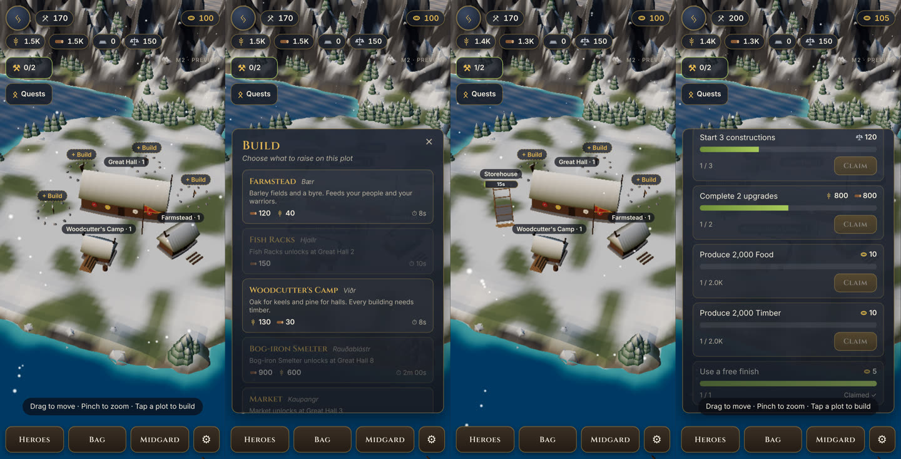

# ⚔️ Jarlheim (VIKEGAME)

> *"Cattle die, kinsmen die… but fame never dies for the one who earns it."* — after *Hávamál*

**A free, easy-to-play, high-quality 3D mobile strategy game set in the real Viking Age.**
Throw your high-seat pillars into the sea and settle where they land. Grow a jarl's hold,
recruit saga heroes like Lagertha and Egil Skallagrímsson, sail the Silver Road to Baghdad,
hunt Fáfnir and the World Serpent, and win the Law Rock at the **Midsummer Thing** to be
crowned King of the North.

> **Challenge #10:** a full 4X mobile strategy game, designed and engineered with **Claude Code**,
> using only free and open-source tools.

**Status:** 🏠 **M2: The Hold.** Build and upgrade a Viking settlement: farms, fish racks, woodcutters, a raised storehouse, a market and a bog-iron smelter. Timers, production while you are away, daily quests, and saving on your device.

### ▶️ Play the preview: **https://moemenakari.github.io/VIKEGAME/**



---

## ✨ What makes it different
- **Real history as mechanics.** Land-taking by carrying fire (*Landnámabók*), blood feud & wergild (*Njáls saga*), outlawry (*Grágás*), royal offices from *Heimskringla*, and research built on the 16 Younger Futhark runes.
- **A monster every day.** Thor's Fishing, the dragon Fáfnir, Draugr Night, the sun-wolves, frost giants, island duels, and a monthly **Ragnarök**.
- **Ships matter.** Snekkja, skeið, knarr and dragon-ships open fast sea routes.
- **Your name in runes.** Deeds are carved on runestones in real Younger Futhark.
- **Free and easy.** One thumb, three taps, everything earnable.

## 📚 Documentation
| Doc | What's inside |
|---|---|
| [Game Design](docs/GDD.md) | Every system: Landnám, resources, the Hold, war & ships, saga heroes, the 16 runes, Midgard map, clans, feuds, feasts, the Thing, seasons |
| [History Bible](docs/HISTORY_BIBLE.md) | The sagas, chronicles, laws and archaeology behind every element |
| [Live Events](docs/LIVE_EVENTS.md) | The weekly hunt calendar, monthly Ragnarök, seasonal festivals |
| [Architecture](docs/ARCHITECTURE.md) | Pure deterministic sim + Three.js renderer, offline progress, performance budgets |
| [Roadmap](docs/ROADMAP.md) | M0 → M11, each milestone playable at a public link |
| [Monetization Plan](docs/MONETIZATION.md) | Free now. How a fair Gold store would work if the game succeeds |
| [Decision Log](docs/DECISIONS.md) | Every key decision and why |
| [Reference Analysis](docs/REFERENCE_ANALYSIS.md) | The genre's systems, reverse-engineered (mechanics only) |

## 🚀 Run it yourself (free and easy)
Requires [Node.js 22+](https://nodejs.org).
```bash
npm install
npm run dev        # opens the game at http://localhost:5173 (also reachable from your phone on the same Wi-Fi)
npm run check      # typecheck + lint + format + unit tests + build + bundle-size budget
npm run e2e        # phone-sized browser smoke test with screenshots
```

## 🛠️ Tech stack (all free)
TypeScript · Three.js · React · Vite · Vitest · Playwright · Capacitor (Android) · GitHub Actions · GitHub Pages

## 🎨 Originality
Mechanics follow mobile 4X genre conventions. Art, audio and UI are original or CC0
(credited in `assets/CREDITS.md`). Historical figures and stories come from public-domain
medieval sources, retold in our own words.
